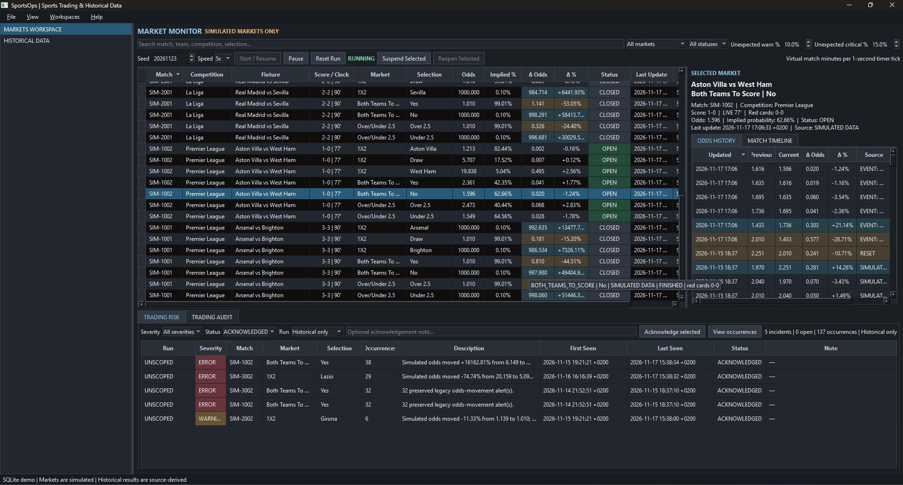
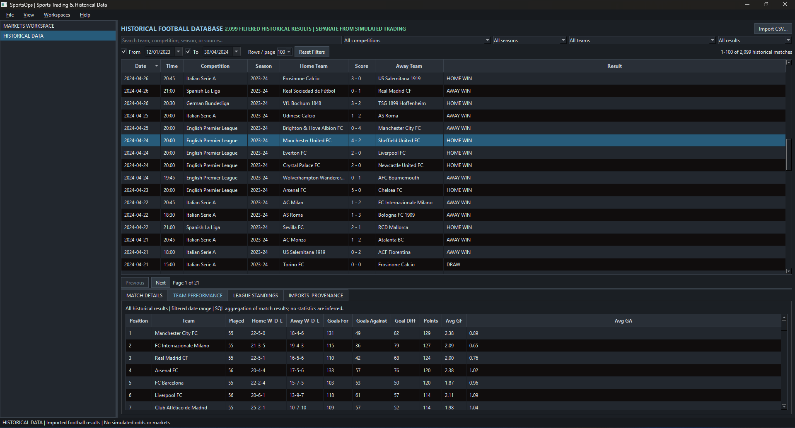
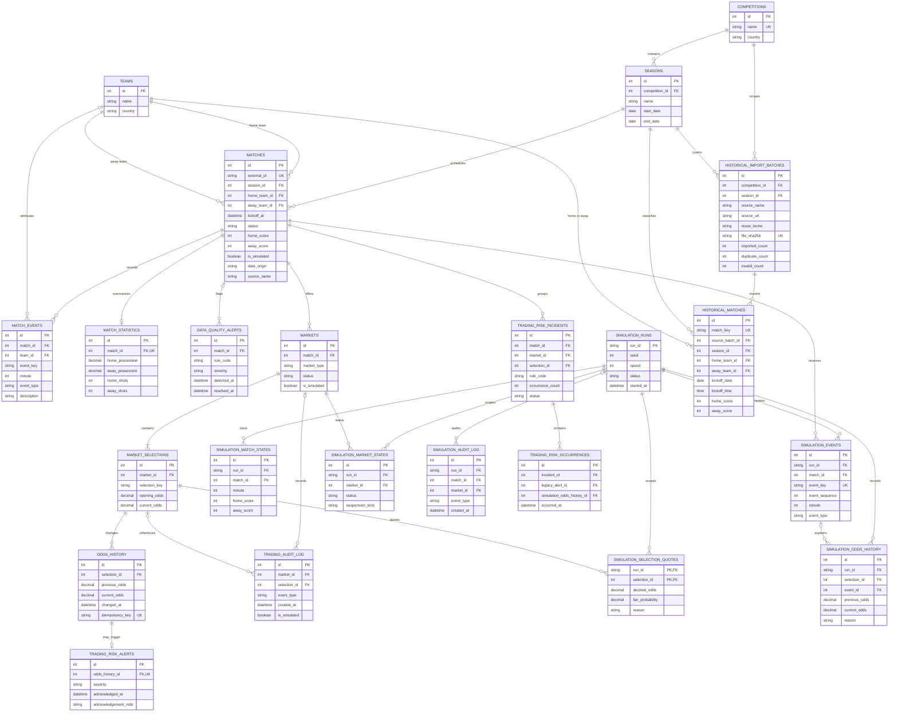

# SportsOps

SportsOps is a native Windows desktop application with exactly two primary
workspaces: **Markets Workspace** for simulated sports-trading operations and
**Historical Data** for real football results and SQL-backed analysis. It uses
PySide6, SQLAlchemy, and SQLite by default; PostgreSQL is supported as an
optional technical database. There are no live sports feeds, bookmaker
connections, or betting transactions.

## Application Screenshots

### Markets Workspace
Live-style football market simulation with event-driven odds updates, match scores, and market controls.


### Trading Risk
Run-scoped risk incident monitoring with severity filters, acknowledgement tracking, and audit history.



### Historical Data
SQL-powered exploration of 8,676 historical football results across four European leagues.



## Requirements

- Windows 10 or later
- Python 3.12 recommended
- No PostgreSQL installation is needed for the local SQLite demo

## Install and launch the SQLite demo

Open PowerShell in the project folder and create the virtual environment:

```powershell
py -3.12 -m venv .venv
```

Install the base app and database packages, then launch the native desktop app:

```powershell
.\.venv\Scripts\python.exe -m pip install -r requirements.txt
.\.venv\Scripts\python.exe -m sportsops
```

On first launch the app creates the SQLite demo records and imports the
bundled, source-derived historical dataset. On Windows, the default database
file is:

```text
%LOCALAPPDATA%\SportsOps\sportsops_demo.sqlite3
```

The directory can be changed by setting `SPORTSOPS_DATABASE_URL`; for
example, `sqlite:///C:/SportsOps/demo.sqlite3`. No system-wide settings or
database server are required.

## Workspaces

The left navigation contains only **Markets Workspace** and **Historical Data**.
Markets Workspace is the default page. The old All Matches tree, match-monitor
workspace, and side details panel are no longer part of primary navigation;
their database records, tables, repositories, and trading foreign-key
relationships are retained.

### Markets Workspace

The dense native Qt market table displays simulated 1X2, Over/Under 2.5, and
Both Teams To Score selections, decimal odds, implied probabilities, odds
movements, market status, and update times. Search and filter by market/status,
and sort by table headings.

- **Start / Resume**, **Pause**, and **Reset Run** control a deterministic
  event-driven football simulation. Choose a signed integer seed and 1x, 5x,
  or 10x speed. Each Qt timer tick occurs once per second and advances each
  active virtual match by that many match minutes. Reset hides that run from
  the active view but retains its events, quotes, odds movements, risk
  occurrences, and audit history. It never resets or rewrites the original
  demo match, market, or historical-result rows.
- A seed and match ID determine each match's goal rates and ordered event
  schedule. The schedule can include kick-off, goals, red cards, half-time,
  second-half kick-off, and full time. The same seed and unchanged demo data
  reproduce the same match schedules. The displayed clock, score, red cards,
  and chronological timeline all come from the persisted simulation run.
- Odds are recalculated at match start, major events, event-market reopening,
  and five-minute clock boundaries. The probability model estimates remaining
  goals with independent Poisson distributions, then derives 1X2, Over/Under
  2.5, and Both Teams To Score outcomes from the current score and clock.
  Red cards reduce the affected side's remaining-goal rate and increase the
  opponent's rate. A 5% notional bookmaker margin is applied to fair
  probabilities before prices are rounded to 0.001. A minimum price of 1.010
  and a maximum price of 1000.000 for every outcome (including very low
  probabilities) mean extreme quotes can deviate from exactly 5% overround;
  the maximum price implies 0.10%. Fair probabilities are stored to nine
  decimal places, so sufficiently small probabilities round to zero and use
  the maximum quote. This is an explainable demonstration model, not a model
  calibrated to real bookmaker prices.
- A goal, red card, or half-time temporarily suspends the affected match's
  open markets. The engine reprices before reopening them on a later tick.
  Manual suspensions remain in force until an operator reopens the market;
  that action also reprices first. Full time closes run-scoped markets, and
  closed markets are never repriced. Manual suspension requires a reason.
- Each significant price change stores its previous/current odds, fair
  probability, percentage movement, triggering event/cause, and explanation.
  Normal model-driven causes (clock, goals, cards, half-time, reopening, and
  full time) remain in the odds and audit history but are not classified as
  trading errors solely because the movement is large. The 10% warning and
  15% critical thresholds apply to price changes with an unexpected cause;
  invalid model prices or probabilities stop the reprice with an explicit
  error. These are local simulated quotes, not external feeds, so an external
  feed-staleness alert is not applicable.
- Risk incidents are scoped to a simulation run. The default risk view shows
  the current or most recent run; **All runs** and **Historical only** expose
  earlier incidents. Resetting or starting another run never deletes an
  incident or occurrence. Existing incidents without safe run attribution are
  retained as **UNSCOPED** history rather than guessed or silently split.
  Repeated unexpected movements for a match/market/selection/rule in one run
  are grouped into an incident with a count and first/last-seen times, while
  every underlying occurrence remains inspectable. Acknowledging an incident
  stores the operator note and starts a 60-second cooldown. SQLite datetimes
  are treated as UTC and displayed in local time with the date and UTC offset,
  so incidents spanning midnight remain unambiguous.
- Trading risk incidents are separate from data-quality alerts. The Trading
  Audit tab records run controls, match events, price repricing, suspension and
  reopening, full-time closure, and risk acknowledgements. Existing Phase 4
  alerts are grouped during startup without deleting or rewriting their
  original rows.
- Market status operations support **OPEN**, **SUSPENDED**, and **CLOSED**.
  The original markets and their opening prices remain unchanged; current
  simulation prices and statuses are run-scoped overlays.

All market updates are simulated. No live feed, bookmaker service, or betting
execution is included.

### Historical Data

The Historical Data workspace contains a paginated, sortable Qt model/view
table. Competition, season, team, date, and result filters are applied in SQL,
not only to the currently visible page. Competition, season, and team
selectors are bidirectionally faceted: each offers values available under the
other two active selections, and incompatible stale selections are reset
without clearing compatible ones. Choosing a team filters by that exact team;
the separate text search remains a partial-name search. **Reset Filters** clears
all active filters.
Select a row to inspect the teams, full-time score, date, and competition.
Source attribution, source URLs, recorded reuse terms, and import fingerprints
remain available in **Imports & Provenance** and are retained in the database.

The bundled dataset contains **8,676 completed results** across four leagues
(English Premier League, German Bundesliga, Spanish La Liga, and Italian Serie
A) from 2018/19 through 2023/24. It was sourced from
[OpenFootball football.json](https://github.com/openfootball/football.json).
Its README states that its schema, data, and scripts are dedicated to the
public domain and may be used without restrictions; the bundled
[provenance notice](./sportsops/data/historical/OPENFOOTBALL_NOTICE.md) records
the source terms and limitations. The data includes dates, team names, and
full-time scores only. Possession, shots, events, and other detailed match
statistics are **unavailable** and are never inferred.

Team performance and league standings are computed with SQL aggregation from
the historical results. **Import CSV...** accepts local results files in the
documented schema, validates scores, season boundaries, and duplicate
fixtures, and records source, reuse terms, file hash, and import counts. Review
each provider's current reuse terms before importing; the importer records the
operator's note but does not evaluate licenses or grant permission.

Historical results are kept in dedicated historical tables and are never
used to create or alter simulated markets. Keyboard shortcuts include
`Ctrl+F` (find in the active workspace), `Ctrl+0` (reset splitters),
`Ctrl+Shift+M` (Markets), and `Ctrl+Shift+H` (Historical Data).

## PostgreSQL

Install PostgreSQL separately if you want to run the production-style database.
Install its Python driver into the project environment:

```powershell
.\.venv\Scripts\python.exe -m pip install -r requirements-postgres.txt
```

Create a PostgreSQL database, then execute [`sql/schema.sql`](./sql/schema.sql)
against that database (for example, with `psql` or pgAdmin). Keep the password
out of the URL and source files; `psycopg` reads it from the process-local
`PGPASSWORD` environment variable:

```powershell
$env:PGHOST = "127.0.0.1"
$env:PGPORT = "5432"
$env:PGUSER = "YOUR_DATABASE_USER"
$env:PGDATABASE = "sportsops"
$securePassword = Read-Host "PostgreSQL password" -AsSecureString
$passwordPointer = [Runtime.InteropServices.Marshal]::SecureStringToBSTR($securePassword)
try {
    $env:PGPASSWORD = [Runtime.InteropServices.Marshal]::PtrToStringBSTR($passwordPointer)
} finally {
    [Runtime.InteropServices.Marshal]::ZeroFreeBSTR($passwordPointer)
    $securePassword.Dispose()
}
$env:SPORTSOPS_DATABASE_URL = "postgresql+psycopg://$($env:PGUSER)@$($env:PGHOST):$($env:PGPORT)/$($env:PGDATABASE)"
.\.venv\Scripts\python.exe -m sportsops
```

Use your own database username and password locally; do not send credentials
in chat or commit them. The environment settings above last only for the
current PowerShell process and its children. The app creates missing tables
through SQLAlchemy, seeds match records only into an empty database, and adds
missing demo markets without replacing existing rows or prices. The bundled
historical CSVs are imported automatically only for the SQLite demo. To use
them with PostgreSQL, import the permitted files through **Historical Data >
Import CSV...** or the CSV CLI. The `schema.sql` DDL uses `IF NOT EXISTS` for
tables and indexes; it does not alter existing columns. Database connection,
SQL, and constraint failures are allowed to surface; they are not replaced
with simulated success data.

`sql/schema.sql` is the hand-written PostgreSQL DDL for inspection and setup.
The ORM models in [`sportsops/database/models.py`](./sportsops/database/models.py)
are the application mapping for both engines. [`sql/analysis_queries.sql`](./sql/analysis_queries.sql)
contains standalone PostgreSQL-compatible analysis examples.

### Reproducing the PostgreSQL integration tests on Windows

The verifier requires a dedicated disposable database named `sportsops_test`.
It creates uniquely named temporary schemas inside that database, executes
`schema.sql`, compares table/column coverage with the ORM, runs the event
simulation and analysis queries, checks constraints/triggers and a
data-preserving migration, and removes only its own temporary schemas. It
refuses any database whose name is not exactly `sportsops_test`; it does not
create or drop the database.

First, verify PostgreSQL is running and accepting connections:

```powershell
Get-Service postgresql-x64-18
Test-NetConnection 127.0.0.1 -Port 5432
```

Create a dedicated database role and database using pgAdmin or `psql` as a
local PostgreSQL administrator. Before creating them, check that neither name
already exists; do not overwrite or repurpose an existing database. For
example, connect to the maintenance database with the administrator account,
then run:

```sql
CREATE ROLE sportsops_test LOGIN;
```

In the `psql` prompt, set that role's password interactively using
`\password sportsops_test` (the password is not part of a SQL statement). Then
create the separate database:

```sql
CREATE DATABASE sportsops_test OWNER sportsops_test;
```

Install the driver into the project virtual environment and configure
connection details in the current PowerShell process. The password prompt is
masked and the verifier URL contains no password:

```powershell
.\.venv\Scripts\python.exe -m pip install -r requirements-postgres.txt
$env:PGHOST = "127.0.0.1"
$env:PGPORT = "5432"
$env:PGUSER = "sportsops_test"
$env:PGDATABASE = "sportsops_test"
$securePassword = Read-Host "sportsops_test password" -AsSecureString
$passwordPointer = [Runtime.InteropServices.Marshal]::SecureStringToBSTR($securePassword)
try {
    $env:PGPASSWORD = [Runtime.InteropServices.Marshal]::PtrToStringBSTR($passwordPointer)
} finally {
    [Runtime.InteropServices.Marshal]::ZeroFreeBSTR($passwordPointer)
    $securePassword.Dispose()
}
$env:SPORTSOPS_TEST_POSTGRES_URL = "postgresql+psycopg://$($env:PGUSER)@$($env:PGHOST):$($env:PGPORT)/$($env:PGDATABASE)"
.\.venv\Scripts\python.exe scripts\verify_postgres.py
.\.venv\Scripts\python.exe scripts\validate_sql.py --database-url $env:SPORTSOPS_TEST_POSTGRES_URL
Remove-Item Env:PGPASSWORD, Env:PGHOST, Env:PGPORT, Env:PGUSER, Env:PGDATABASE, Env:SPORTSOPS_TEST_POSTGRES_URL
```

Do not point this verifier at a production or shared database. If any command
fails, fix the local service, credentials, or role/database setup before
rerunning it. The SQLite user database and packaged app are not involved.

## Entity relationship diagram



## Database design

- **`competitions` and `seasons`** separate competition identity from a
  competition's season. Season names are unique within a competition and dates
  are checked.
- **`teams`** stores reusable team identities, unique by name and country.
- **`matches`** references its season and distinct home/away teams. External
  IDs are unique; status, nonnegative scores, and elapsed minutes are checked.
  `updated_at` records the last persisted update time.
  `data_origin`, `source_name`, and optional `source_reference` label the
  record's provenance; origin and simulated-state constraints must agree.
- **`match_events`** stores event-level detail. `(match_id, event_key)` is
  unique, and match/minute is indexed for timeline queries.
- **`match_statistics`** stores one statistics row per match, with possession
  ranges and shot-count constraints.
- **`data_quality_alerts`** records rule, severity, message, detection time,
  optional acknowledgement/resolution times. Deleting a match preserves its
  alert while clearing the match reference.
- **`markets` and `market_selections`** normalize each match's 1X2,
  Over/Under 2.5, and Both Teams To Score markets. A match can have only one
  market of each type; selection keys are unique within a market. Opening and
  current decimal odds must both be greater than 1.
- **`odds_history`** links each simulated price change to one market
  selection, recording previous/current prices, timestamp, source, and a
  unique idempotency key. Absolute and percentage changes are derived from
  those stored values.
- **`trading_risk_alerts`** references the price movement that triggered it,
  and persists severity, acknowledgement timestamp, and optional operator
  note. It remains separate from `data_quality_alerts`.
- **`trading_audit_log`** stores market actions and simulated updates. SQLite
  triggers and the PostgreSQL DDL reject updates/deletes so audit entries are
  append-only.
- **Phase 6 simulation tables** keep every run separate from base match and
  market rows. `simulation_match_states` stores the run's score and clock;
  `simulation_events` is an ordered, uniquely keyed event ledger;
  `simulation_market_states` and `simulation_selection_quotes` hold
  run-scoped status and prices; `simulation_odds_history` stores explainable
  price movements; and `simulation_audit_log` records simulation operations.
  `simulation_market_controls` carries operator suspensions between runs.
- **`trading_risk_incidents` and `trading_risk_occurrences`** group repeated
  movements by match, market, selection, and rule. Occurrence rows are
  append-only and link either a legacy Phase 4 alert or one Phase 6 odds
  movement. Legacy alert rows remain unchanged; startup backfills their group
  records idempotently.
- **`historical_import_batches` and `historical_matches`** hold user-imported
  completed results separately from monitor matches and trading markets.
  Batch rows record source URL, the operator's reuse-terms note, file SHA-256,
  row counts, and import timestamp. Historical rows retain their source batch,
  CSV row number, match key, result, and optional kickoff time. They share
  normalized competition/season/team identities but do not feed markets or
  simulation.

On an existing database, startup creates the additive Phase 6 tables and
append-only ledger triggers without dropping or rewriting existing user data.
It preserves legacy markets, odds history, risk alerts, and audit entries;
historical tables are not modified by trading simulation.
It also continues to migrate `matches.updated_at` and
`data_quality_alerts.acknowledged_at` for older databases. Missing demo
markets are inserted idempotently for simulated matches; existing markets and
prices are not overwritten.

The model uses integer surrogate primary keys, foreign keys, `DATE`,
timezone-aware timestamps, `BOOLEAN`, `NUMERIC`, and bounded text types. The
schema is normalized around competitions, seasons, teams, matches, events,
statistics, and alerts. SQLite enables foreign-key enforcement on every
connection.

The base seed contains seven synthetic demo matches, three competitions, three
seasons, fourteen teams, match statistics, and 15 simulated events. Match
records also have an explicit `data_origin`; the desktop identifies the demo
rows as synthetic. Each eligible match receives three markets and seven
selections, each linked by foreign key. Phase 6 does not edit these original
seed rows; its run state, simulation events, and quotes are stored separately.

## Data validation

Seed/input validation checks for duplicate events, negative or partial scores,
missing match fields or events, invalid minutes, impossible shot totals,
possession totals that do not add to approximately 100%, same-team fixtures,
invalid statuses, and events attributed to non-participant teams. Database
validation also scans for duplicate event fingerprints, invalid/missing
scores, missing statistics, inconsistent statistics, and event/team
mismatches. Findings are stored in `data_quality_alerts`; new findings are
logged and repeated unresolved alerts are not duplicated.

Database constraints reject invalid persisted values where practical. The
validation layer provides additional diagnostics for cross-row inconsistencies
that a simple row constraint cannot express.

## Historical football CSV imports and provenance

The bundled source is [OpenFootball football.json](https://github.com/openfootball/football.json).
Its repository README states that its schema, data, and scripts are dedicated
to the public domain and may be used without restrictions. The source and terms
are recorded in [`OPENFOOTBALL_NOTICE.md`](./sportsops/data/historical/OPENFOOTBALL_NOTICE.md)
and [`bundle_manifest.json`](./sportsops/data/historical/bundle_manifest.json).
No third-party data was invented. The bundle contains the 8,676 completed
full-time results reported in the manifest; the SQLite demo imports them
idempotently on first launch. Existing historical rows are retained and are
never overwritten by the bundle importer.

The generic importer accepts (`Date`, `HomeTeam`, `AwayTeam`, `FTHG`, `FTAG`,
and optional `FTR` and `Time`), checks season bounds, score/result consistency,
team names, and duplicate fixtures, and stores valid rows with source-batch
provenance. Rows with validation issues are reported and skipped while valid
rows in the same file can still be imported. Importing never adds rows to
`matches`, generates markets, or changes trading simulation data. Exact file
repeats are detected by SHA-256; fixture repeats by normalized competition,
season, date, and home/away names.

Before importing another provider's file, review current reuse terms and
confirm they allow your intended use. The importer records the source and the
operator's reuse-terms note; **it does not verify a license or grant
permission**. For a permitted dataset, save the CSV locally and use the desktop
**Import CSV...** action or the command line (edit the values and dates):

```powershell
.\.venv\Scripts\python.exe -m sportsops.data.import_historical "C:\Data\results.csv" `
  --competition "Example League" `
  --country "Example Country" `
  --season "2025/26" `
  --season-start 2025-08-01 `
  --season-end 2026-06-30 `
  --source-name "Dataset provider" `
  --source-url "https://provider.example/results.csv" `
  --reuse-terms "Terms reviewed YYYY-MM-DD; intended use permitted"
```

The command uses the configured SportsOps database (the same
`SPORTSOPS_DATABASE_URL` as the app, or the default per-user SQLite database).
It prints imported, duplicate, and invalid-row counts; invalid rows include
source CSV row numbers. The bundle importer runs automatically only for the
SQLite demo. PostgreSQL users can use the desktop CSV importer or the CLI to
load any source they are permitted to use.

## SQL analysis examples

The complete set is in [`sql/analysis_queries.sql`](./sql/analysis_queries.sql).
It includes 23 runnable, business-commented queries, including match analysis,
odds movements, risk-alert acknowledgement rates, market status, audit
activity, historical results, import lineage, and data-quality checks, such as:

```sql
SELECT c.name AS competition, COUNT(*) AS matches,
       AVG(m.home_score + m.away_score) AS avg_goals
FROM matches AS m
JOIN seasons AS s ON s.id = m.season_id
JOIN competitions AS c ON c.id = s.competition_id
WHERE m.home_score IS NOT NULL AND m.away_score IS NOT NULL
GROUP BY c.name
HAVING AVG(m.home_score + m.away_score) > 2.0;
```

The examples demonstrate joins, aggregation, `HAVING`, `CASE`, common table
expressions, subqueries, `UNION ALL`, window functions (`RANK`, `LAG`, and
running/team analyses), and data-quality checks. They use SQL supported by
PostgreSQL and SQLite.

Run all 23 statements against an isolated in-memory SQLite database with
clearly labeled synthetic demo rows:

```powershell
.\.venv\Scripts\python.exe scripts\validate_sql.py
```

The script reports each query's result count and prints sample aggregate and
data-origin results. It intentionally does not import the separate licensed
historical bundle, so historical query 18 returns no rows in this synthetic-only
validation fixture. The app's SQLite database contains the 8,676 bundled
historical results. To validate a database you already initialized, pass its
URL; the script runs the queries in a read-only transaction and does not create
its schema:

```powershell
.\.venv\Scripts\python.exe scripts\validate_sql.py `
  --database-url "sqlite:///C:/Users/you/AppData/Local/SportsOps/sportsops_demo.sqlite3"
```

### Sample output (isolated synthetic demo, not historical results)

Generated by `scripts/validate_sql.py`; the kickoff timestamps are the fixed
values in the synthetic demo fixtures:

```text
Query 02:
La Liga | 2025/26 | 2 | 4 | 2.0
Premier League | 2025/26 | 3 | 3 | 1.0
Serie A | 2025/26 | 2 | 4 | 2.0
Query 23:
SYNTHETIC | SportsOps synthetic demo | 7 | 2026-11-13 19:45:00.000000 | 2026-11-15 16:30:00.000000
Query 18: no historical rows imported in the demo database.
```

### Historical data check

The imported results were verified through the SQLAlchemy repository and the
same query path used by the workspace:

```text
Dataset rows: 8,676 across 4 competitions and 6 seasons
English Premier League | 2022-23 | 380 matches | 20 teams
Manchester City FC | Played 38 | Points 89 | Goals 94-33 | Avg GF 2.47
```

## Architecture

- [`sportsops/database/models.py`](./sportsops/database/models.py): SQLAlchemy
  relational models and constraints.
- [`sportsops/database/engine.py`](./sportsops/database/engine.py): database
  URL configuration, SQLite foreign-key setup, schema initialization, and
  first-run seed orchestration.
- [`sportsops/database/seed.py`](./sportsops/database/seed.py): idempotent
  normalized demo-data insertion.
- [`sportsops/database/repository.py`](./sportsops/database/repository.py):
  query and map persisted matches, events, and alerts for the Qt model/view UI.
- [`sportsops/database/service.py`](./sportsops/database/service.py): scoped
  database sessions, market operations, simulated price changes, and persisted
  alert acknowledgement.
- [`sportsops/database/trading_repository.py`](./sportsops/database/trading_repository.py):
  market, odds-history, risk-alert, and audit queries and transactional
  operations.
- [`sportsops/database/migrations.py`](./sportsops/database/migrations.py):
  safe additive migrations for older SQLite/PostgreSQL columns and the
  append-only trading and simulation-ledger triggers.
- [`sportsops/database/historical_repository.py`](./sportsops/database/historical_repository.py):
  CSV validation, provenance, SHA-256 repeat detection, fixture deduplication,
  and historical-result reads.
- [`sportsops/data/import_historical.py`](./sportsops/data/import_historical.py):
  local-file import CLI; it never downloads a dataset.
- [`sportsops/data/historical_bundle.py`](./sportsops/data/historical_bundle.py):
  SQLite-only, manifest-validated import of the bundled source CSV files.
- [`sportsops/ui/historical_workspace.py`](./sportsops/ui/historical_workspace.py):
  SQL-filtered, paginated results table, match details, team/league
  aggregation, and import interface.
- [`scripts/validate_sql.py`](./scripts/validate_sql.py) and
  [`scripts/verify_postgres.py`](./scripts/verify_postgres.py): repeatable
  PostgreSQL-compatible query validation and optional isolated-schema
  PostgreSQL integration checks.
- [`sportsops/database/validation.py`](./sportsops/database/validation.py):
  input/database checks and alert persistence.
- [`sportsops/services/simulation.py`](./sportsops/services/simulation.py):
  legacy simulated-match helper retained for existing Phase 1–3 callers.
- [`sportsops/services/football_simulation.py`](./sportsops/services/football_simulation.py):
  reproducible event schedules and the Poisson-based probability/odds model.
- [`sportsops/database/simulation_repository.py`](./sportsops/database/simulation_repository.py):
  run-scoped match state, event, odds, market-status, risk-grouping, and audit
  persistence.
- [`sportsops/services/market_simulation.py`](./sportsops/services/market_simulation.py):
  UI controller for start/pause/reset and speed control of event-driven runs.
- [`sportsops/data/seed_data.py`](./sportsops/data/seed_data.py): explicitly
  simulated seed fixtures, separate from the desktop UI.
- [`sportsops/ui/`](./sportsops/ui): native PySide6 interface with only the
  Markets and Historical Data destinations, plus Qt model/view tables,
  resizable panels, trading-risk/audit workflows, and import/provenance views.

The application loads database records into its Qt table model on startup.
The data-access code is kept separate from widgets so later changes can add
database workflows without turning the app into a web or dashboard
application.

See [`ARCHITECTURE.md`](./ARCHITECTURE.md) for the application boundaries,
data flows, migration approach, and Phase 5A limitations.

## Database verification and PostgreSQL integration

SQLite is the default database for the desktop demo and automated unit tests.

PostgreSQL 18 integration was successfully verified on a local Windows installation using the dedicated `sportsops_test` database. All nine integration checks passed, covering schema creation, ORM compatibility, simulation persistence, timezone handling, numeric constraints, SQL analysis queries, legacy migrations, and append-only audit protection.

The automated Python test suite passed 59 tests, and all 23 SQL analysis queries passed validation using the isolated SQLite demo database.

The PostgreSQL integration checks require a locally configured PostgreSQL server and are not executed as part of the default unit test suite.

## Tests

Run the automated tests from the project folder:

```powershell
.\.venv\Scripts\python.exe -m unittest discover -s tests -v
```

Tests use isolated in-memory SQLite databases; no PostgreSQL server or live
data is needed. They verify seed contents and repeatability, constraints,
validation and alert acknowledgement persistence, market odds and filtering,
risk thresholds and notes, market transitions, append-only auditing,
deterministic event generation, second-half transitions, score/event
consistency, simulation reset, risk grouping, UI navigation, and execution of
all 23 analysis queries. Historical import tests use test-created CSVs, not a
third-party or purportedly real dataset.
