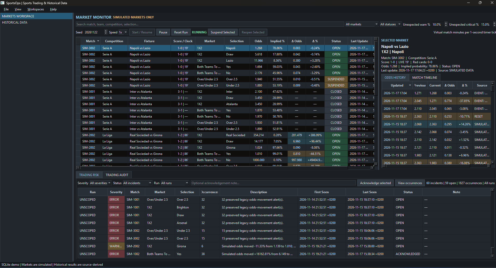

# SportsOps

SportsOps is a native Windows desktop application with exactly two primary
workspaces: **Markets Workspace** for simulated sports-trading operations and
**Historical Data** for real football results and SQL-backed analysis. It uses
PySide6, SQLAlchemy, and SQLite by default; PostgreSQL is supported as an
optional technical database. There are no live sports feeds, bookmaker
connections, or betting transactions.

## Download SportsOps for Windows

**Latest release: [SportsOps v1.0.1](https://github.com/gh-395/SportsOps/releases/tag/v1.0.1)**

To run SportsOps without installing Python:

1. Download `SportsOps-v1.0.1-Windows.zip` from the release page.
2. Extract the ZIP archive.
3. Open `SportsOps.exe` inside the extracted `SportsOps` folder.

The Windows executable has been tested successfully on two separate computers.

### What's New in v1.0.1

- Added **Simulate Risk Event**, allowing users to generate unexpected odds movements and test risk detection.
- Integrated simulated risk events with Trading Risk monitoring and Odds History.
- Improved dark theme consistency across Windows Light and Dark modes.
- Fixed database lookup errors affecting risk event simulation.

## Application Screenshots

### Markets Workspace
Live-style football market simulation with event-driven odds updates, match scores, and market controls.



### Trading Risk
Run-scoped risk incident monitoring with severity filters, acknowledgement tracking, and audit history.


### Historical Data
SQL-powered exploration of 8,676 historical football results across four European leagues.


## Requirements

- Windows 10 or later
- Python 3.12 recommended
- No PostgreSQL installation is needed for the local SQLite demo

## Install and launch the SQLite demo

Open PowerShell in the project folder and create the virtual environment:

```powershell
py -3.12 -m venv .venv
```

Install the base app and database packages, then launch the native desktop app:

```powershell
.\.venv\Scripts\python.exe -m pip install -r requirements.txt
.\.venv\Scripts\python.exe -m sportsops
```

On first launch the app creates the SQLite demo records and imports the
bundled, source-derived historical dataset. On Windows, the default database
file is:

```text
%LOCALAPPDATA%\SportsOps\sportsops_demo.sqlite3
```

The directory can be changed by setting `SPORTSOPS_DATABASE_URL`; for
example, `sqlite:///C:/SportsOps/demo.sqlite3`. No system-wide settings or
database server are required.

## Workspaces

SportsOps features two main workspaces: **Markets Workspace** for football trading simulations and **Historical Data** for SQL-based football analysis.

### Markets Workspace

An interactive football trading environment that simulates live matches, dynamic betting markets, and risk management operations.

**Key Features:**

- **Live Match Simulation:** Simulate football matches with goals, red cards, and event-driven updates. Pause, resume, reset, or adjust simulation speed.
- **Dynamic Odds Engine:** Calculate odds for 1X2, Over/Under 2.5, and Both Teams To Score markets using a probability-based model.
- **Market Management:** Suspend, reopen, and close markets through automated events or manual controls.
- **Trading Risk Monitoring:** Detect unusual odds movements, classify incidents by severity, and manage acknowledgements.
- **Risk Event Simulation:** Trigger unexpected odds movements to demonstrate automated risk detection.
- **Odds History & Audit Trail:** Track price changes, match events, market operations, and risk incidents.
- **Persistent Data:** Store simulation runs, market changes, and incident history in a relational database.
### Historical Data

The Historical Data workspace contains a paginated, sortable Qt model/view
table. Competition, season, team, date, and result filters are applied in SQL,
not only to the currently visible page. Competition, season, and team
selectors are bidirectionally faceted: each offers values available under the
other two active selections, and incompatible stale selections are reset
without clearing compatible ones. Choosing a team filters by that exact team;
the separate text search remains a partial-name search. **Reset Filters** clears
all active filters.
Select a row to inspect the teams, full-time score, date, and competition.
Source attribution, source URLs, recorded reuse terms, and import fingerprints
remain available in **Imports & Provenance** and are retained in the database.

The bundled dataset contains **8,676 completed results** across four leagues
(English Premier League, German Bundesliga, Spanish La Liga, and Italian Serie
A) from 2018/19 through 2023/24. It was sourced from
[OpenFootball football.json](https://github.com/openfootball/football.json).
Its README states that its schema, data, and scripts are dedicated to the
public domain and may be used without restrictions; the bundled
[provenance notice](./sportsops/data/historical/OPENFOOTBALL_NOTICE.md) records
the source terms and limitations. The data includes dates, team names, and
full-time scores only. Possession, shots, events, and other detailed match
statistics are **unavailable** and are never inferred.

Team performance and league standings are computed with SQL aggregation from
the historical results. **Import CSV...** accepts local results files in the
documented schema, validates scores, season boundaries, and duplicate
fixtures, and records source, reuse terms, file hash, and import counts. Review
each provider's current reuse terms before importing; the importer records the
operator's note but does not evaluate licenses or grant permission.

Historical results are kept in dedicated historical tables and are never
used to create or alter simulated markets. Keyboard shortcuts include
`Ctrl+F` (find in the active workspace), `Ctrl+0` (reset splitters),
`Ctrl+Shift+M` (Markets), and `Ctrl+Shift+H` (Historical Data).

## Technical Documentation

For database design, PostgreSQL setup, SQL analysis, architecture, and testing, see [Technical Documentation](docs/TECHNICAL.md).
